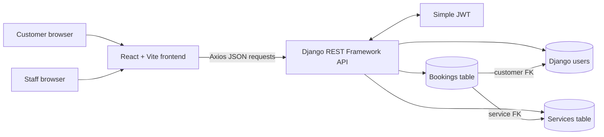

# Architecture and Data Flow

## Components

## Request flow

1. React pages call one Axios client. Its API base URL comes from `VITE_API_BASE_URL` and defaults to `http://127.0.0.1:8000/api` for development.
2. Public service browsing sends a request to Django without a token. The service view returns only active services to public users.
3. Registration validates the request, runs Django password validators, and stores a hashed password using `create_user`.
4. Login obtains an access and refresh token from Simple JWT. The Axios client attaches the access token and refreshes it after an expired-token response.
5. Django permissions authorize each protected request. Booking ownership comes from `request.user`; submitted user IDs, prices, and statuses are not accepted as authoritative booking fields.
6. Django ORM queries and migrations persist records in MySQL.

## Main data relationships

- Django's built-in `User` is retained because its initial migrations already existed before this feature work. Staff status is represented by Django's `is_staff` flag.
- A `Service` holds its name, category, description, current price, active flag, and timestamps.
- A `Booking` belongs to one customer and one service. It snapshots the service price when the booking is created, so later price edits do not change older bookings.
- Deleting a service referenced by a booking is protected. Staff should deactivate services instead.

## Code map

- `frontend/src/api/client.js`: Axios base URL and JWT refresh behavior.
- `frontend/src/context/AuthContext.jsx`: client-side login state.
- `backend/accounts/`: registration and current-profile endpoints.
- `backend/services/`: catalog model, serializers, views, and staff-only writes.
- `backend/bookings/`: ownership, date validation, price snapshots, and status transition rules.
- `backend/config/settings.py`: environment values, MySQL, DRF, CORS, and JWT settings.
