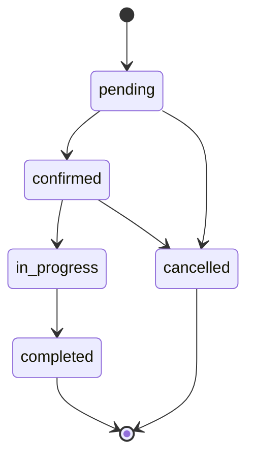

# Customer and Admin Workflows

## Customer

1. Create an account at `/register/` or sign in at `/login/`.
2. Browse live catalog entries from `GET /api/services/` and open a service booking form.
3. Submit service, date, time, address, and optional notes to `POST /api/bookings/`.
4. Django checks that the service is active and the date is not in the past. It assigns the authenticated customer, snapshots the current service price, and starts the booking as `pending`.
5. View private booking history at `GET /api/my-bookings/`. A user cannot list another customer's bookings.
6. Log out to clear the current browser session's tokens.

## Admin/staff

1. Create a staff account with `python manage.py createsuperuser` or grant staff status to a trusted user through Django admin.
2. Sign in through the same JWT login page. A staff profile receives the `admin` UI role from the server.
3. Manage services in the frontend `/admin` dashboard: add, edit, activate, and pause entries. Inactive services are hidden from public browsing and new bookings. The separate Django admin is `/admin/` on the backend host.
4. Review all requests from `GET /api/admin/bookings/` and use `PATCH /api/bookings/{id}/status/` to progress them.

## Booking status transitions



Only staff can change status. The API rejects invalid jumps and treats `completed` and `cancelled` as terminal states.

## API authentication

Pass the access token in the header for protected endpoints:

```http
Authorization: Bearer <access-token>
```

`POST /api/token/` accepts a username and password. `POST /api/token/refresh/` accepts a refresh token. The browser client refreshes access tokens automatically when a protected request returns 401 and clears the session if refresh fails.
